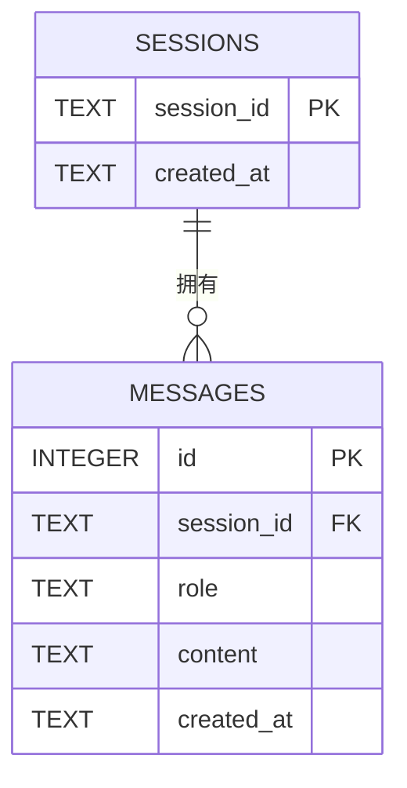

# 智能机器人 API

FastAPI + SQLAlchemy ORM + SQLite 的流式聊天机器人。前端为纯 HTML/CSS/原生 JS 页面，由后端 `StaticFiles` 挂载，无需单独启动前端服务。

## 功能

- 普通聊天接口（一次性返回）与 SSE 流式接口（打字机效果）
- 会话与消息通过 **SQLAlchemy 2.x ORM** 持久化到 SQLite，服务重启后历史不丢失
- 会话的创建、列表、历史查询、清空
- 历史消息支持 **按关键词过滤**（`GET /sessions/{id}/messages?keyword=...`）
- 三种角色模式：单词讲解（word）、语法纠错（correct）、出题（quiz）

## 第五次作业变更（ORM 拓展）

在第四次作业（裸 `sqlite3`）的基础上：

1. **新增 `models.py`**：用 SQLAlchemy 2.x 声明式模型定义 `Session`/`Message`，含主键、外键与 `relationship`（1:N + cascade）。
2. **重构 `store.py`**：所有 SQL 改为 ORM 查询；用 `session_scope()` 统一管理每个 Session 的打开/提交/回滚/关闭；新增 `add_round()` 把一轮对话（user + assistant）写入**同一事务**。
3. **关键词查询**：`GET /sessions/{id}/messages` 增加可选 `keyword` 参数，用 ORM `contains` 查询过滤当前会话。
4. **向后兼容**：模型完全映射第四次作业的现有表，启动时只补建缺失的表（`create_all` checkfirst），**不删旧表、不清空数据**，旧聊天记录仍可读取。

## 快速开始

```bash
pip install -r requirements.txt
cp .env.example .env      # 填入自己的 API_KEY / BASE_URL / MODEL_NAME
python main.py
```

浏览器访问 <http://127.0.0.1:8000>

## 项目结构

```
intelligent-robot/
├── main.py        # FastAPI 路由、LLM 调用封装、静态挂载（不含 SQL）
├── models.py      # SQLAlchemy ORM 模型（Session / Message）
├── store.py       # 所有数据库读写（ORM + 事务管理，路由层不含 SQL）
├── config.py      # 配置加载（.env）
├── static/index.html
└── tests/         # pytest 用例（离线，无需真实 API Key）
```

## API

| 方法 | 路径 | 说明 |
|---|---|---|
| POST | `/chat` | 一次性返回回复（user+assistant 同事务写入） |
| POST | `/chat/stream` | SSE 流式返回 |
| POST | `/sessions` | 新建会话 |
| GET | `/sessions` | 会话列表 |
| GET | `/sessions/{session_id}/messages` | 查询历史消息；可选 `?keyword=关键词` 过滤 |
| DELETE | `/sessions/{session_id}` | 清空会话 |

## 数据模型（ER 图）

会话与消息保存在 SQLite `chat.db`，由 `store.py` 经 ORM 读写，首次启动自动建表（只建缺失的表）。



### ORM 模型 ↔ 数据库表对应关系

| ORM 模型 | 表名 | 字段（Mapped 列） | 映射约束 |
|---|---|---|---|
| `Session` | `sessions` | `session_id` | `String` 主键（PK） |
| `Session` | `sessions` | `created_at` | `Text NOT NULL`，`server_default=CURRENT_TIMESTAMP` |
| `Session.messages` | — | `relationship` | 1:N，`cascade=all, delete-orphan`，删除会话级联删消息 |
| `Message` | `messages` | `id` | 整型自增主键 |
| `Message` | `messages` | `session_id` | `ForeignKey(sessions.session_id)` NOT NULL |
| `Message` | `messages` | `role` / `content` | `Text NOT NULL` |
| `Message` | `messages` | `created_at` | `Text NOT NULL`，`server_default=CURRENT_TIMESTAMP` |
| `Message.session` | — | `relationship` | 反向 `back_populates` |

> 表名/列名/列类型与第四次作业 `CREATE TABLE` 完全一致，故旧库无需迁移即可被 ORM 读取；若后续调整表结构，应同步更新本 ER 图并提供升级（如 `alembic` 或一次性 `ALTER`）办法。

### ORM 查询 ↔ SQL 对照

本次实现的关键词查询（`store.get_messages` 传 `keyword`）：

```python
stmt = (
    select(Message.role, Message.content, Message.created_at)
    .where(Message.session_id == session_id)
    .order_by(Message.id)
)
if keyword:
    stmt = stmt.where(Message.content.contains(keyword))
rows = s.execute(stmt).all()
```

对应的 SQL 语句：

```sql
SELECT messages.role, messages.content, messages.created_at
FROM messages
WHERE messages.session_id = ?
  AND messages.content LIKE '%' || ? || '%'   -- contains(keyword)
ORDER BY messages.id;
```

**两者关系**：左边是 Python 端的 SQLAlchemy ORM 查询表达式（用模型和列对象描述"要查什么"），
SQLAlchemy 在 `execute()` 时把它编译成右边这条参数化 SQL 交给 SQLite 执行；
`contains(keyword)` 编译为 `LIKE '%keyword%'`，绑定参数而非字符串拼接，避免 SQL 注入，
也让开发者用面向对象的模型描述查询而不必手写 SQL。

## 测试（离线运行）

```bash
pip install -r requirements.txt
pytest -q
```

- `tests/test_orm.py`：ORM 存储（重开连接后旧数据仍可读、会话隔离）、事务回滚（写失败不留半轮）、关键词查询。
- `tests/test_api_search.py`：`/sessions/{id}/messages` 的 `keyword` 参数端到端验证 + 404。
- 测试用 `CHAT_DB_PATH` 指向临时库、注入占位 API Key，并 mock 掉真实 LLM 调用，**不需要真实 Key、不联网**。

## 说明

- `*.db`、`.env` 等已列入 `.gitignore`，不随仓库提交。
- **API Key 只放服务端 `.env`，绝不明文写进 README / 提交到仓库。**