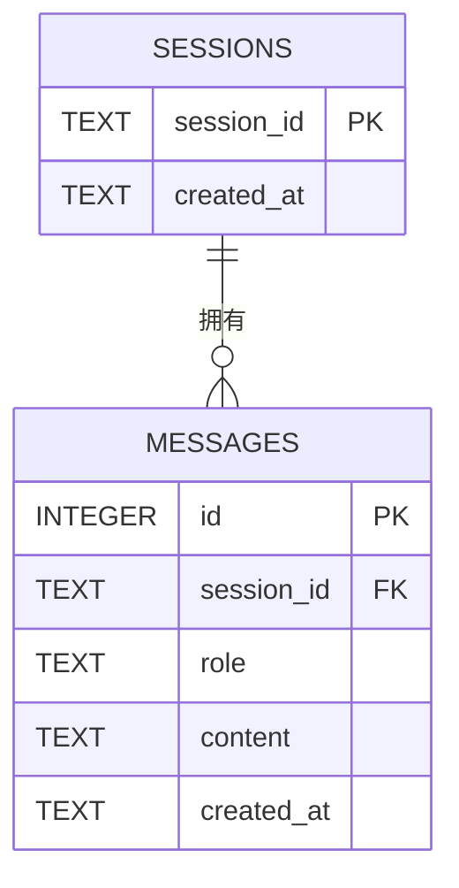

# 智能机器人 API

FastAPI + SQLite 的流式聊天机器人。前端为纯 HTML/CSS/原生 JS 页面，由后端 `StaticFiles` 挂载，无需单独启动前端服务。

## 功能

- 普通聊天接口，一次性返回完整回复
- SSE 流式接口，前端打字机效果
- 会话与消息持久化到 SQLite，**服务重启后历史不丢失**
- 会话的创建、列表、历史查询、清空
- 三种角色模式：单词讲解（word）、语法纠错（correct）、出题（quiz）

## 快速开始

```bash
pip install -r requirements.txt
cp .env.example .env      # 填入自己的 API_KEY / BASE_URL / MODEL_NAME
python main.py

```

浏览器访问 <http://127.0.0.1:8000>

## 项目结构

```
intelligent robot/
├── main.py            # FastAPI 路由、LLM 调用封装、静态挂载
├── store.py           # 所有 SQLite 读写（路由层不含 SQL）
├── config.py          # 配置加载（.env）
├── static/index.html  # 前端页面
├── tests/             # pytest 用例
└── chat.db            # SQLite 数据库（不提交）

```

## API

| 方法 | 路径 | 说明 |
|---|---|---|
| POST | `/chat` | 一次性返回回复 |
| POST | `/chat/stream` | SSE 流式返回 |
| POST | `/sessions` | 新建会话 |
| GET | `/sessions` | 会话列表 |
| GET | `/sessions/{session_id}/messages` | 查询历史消息 |
| DELETE | `/sessions/{session_id}` | 清空会话 |

## 数据存储与 ER 图

会话与消息保存在 SQLite 数据库 `chat.db`，由 `store.py` 统一读写，首次启动自动建表。
**每条消息独立成行存储**，未使用 JSON 整段序列化；服务重启后通过
`GET /sessions/{session_id}/messages` 仍可取回完整历史。



### 字段说明

| 表 | 字段 | 类型 | 约束 | 说明 |
|---|---|---|---|---|
| sessions | session_id | TEXT | PRIMARY KEY | 会话唯一标识 |
| sessions | created_at | TEXT | NOT NULL，默认当前时间 | 创建时间 |
| messages | id | INTEGER | PRIMARY KEY AUTOINCREMENT | 消息自增主键 |
| messages | session_id | TEXT | NOT NULL，FK → sessions.session_id | 所属会话 |
| messages | role | TEXT | NOT NULL | `user` / `assistant` |
| messages | content | TEXT | NOT NULL | 消息正文 |
| messages | created_at | TEXT | NOT NULL，默认当前时间 | 写入时间 |

- 关系：一个 `sessions` 对应 0..N 条 `messages`（1:N）。
- 外键通过 `PRAGMA foreign_keys = ON` 显式开启。
- 索引 `idx_messages_session(session_id, id)` 加速按会话顺序读取。

> 说明：mermaid 的 `erDiagram` 语法不支持 `NOT NULL` / `AUTOINCREMENT` 等修饰，
> 故图中只标注 PK / FK，完整约束见上表，与 `store.py` 的 `CREATE TABLE` 一致。

## 测试

```bash
pytest -q

```

测试通过环境变量 `CHAT_DB_PATH` 指向独立临时库，并 monkeypatch 掉真实 LLM 调用，
不依赖网络、不读写本地 `.env` 与真实 `chat.db`。

## 说明

- `*.db`、`.env`、`.chat_history.json` 已列入 `.gitignore`，不随仓库提交。
- API Key 仅保存在服务端，不下发到前端。